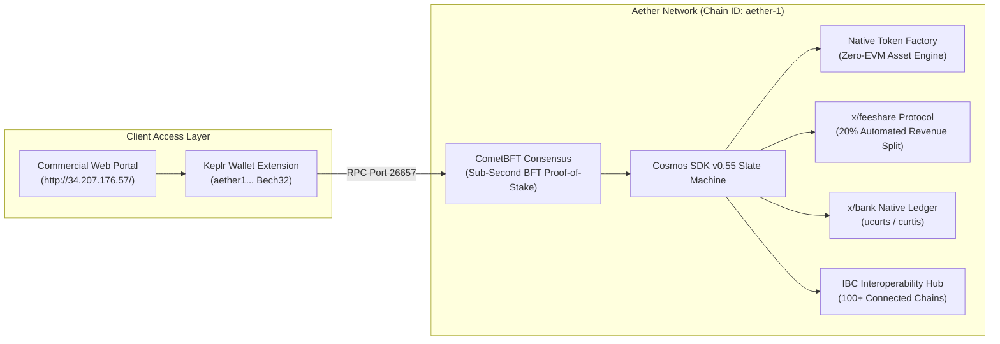
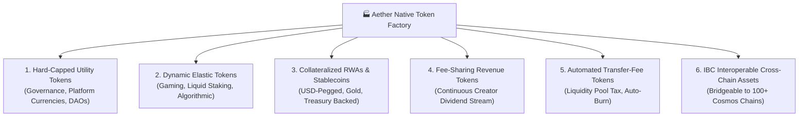
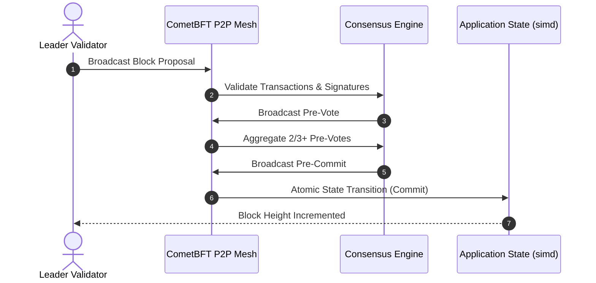
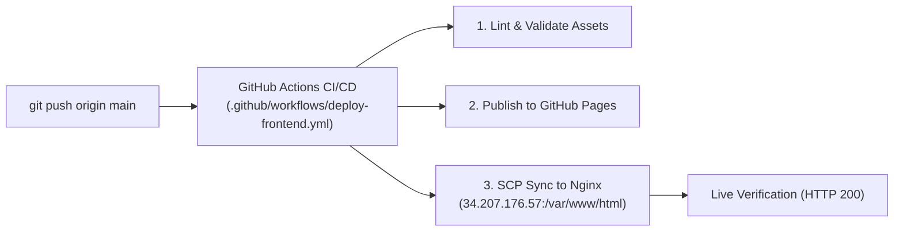

<div align="center">

# ⚡ AETHER NETWORK (`aether-1`)
### High-Throughput Sovereign Layer-1 Blockchain for Multi-Tenant Asset Issuance & Automated Developer Monetization

[](http://34.207.176.57:26657/status)
[](http://34.207.176.57:26657)
[](http://34.207.176.57:26657/status)
[](http://34.207.176.57:1317/cosmos/bank/v1beta1/denoms_metadata)
[](http://34.207.176.57:1317)
[](LICENSE)

---

[🌐 Live Web Portal](http://34.207.176.57/) • [📡 CometBFT RPC API](http://34.207.176.57:26657) • [🔌 Cosmos REST API](http://34.207.176.57:1317) • [📖 Technical Documentation](#-table-of-contents)

---

</div>

## 📌 Table of Contents

- [1. Executive Overview](#1-executive-overview)
- [2. Architectural Superiority (How Aether Differs)](#2-architectural-superiority-how-aether-differs)
- [3. Cryptocurrency Archetypes (Asset Issuance Engine)](#3-cryptocurrency-archetypes-asset-issuance-engine)
- [4. Consensus Engine & State Machine Economics](#4-consensus-engine--state-machine-economics)
- [5. 5-Minute Reviewer Quickstart](#5-5-minute-reviewer-quickstart)
- [6. Live Cloud Network & Public Endpoints](#6-live-cloud-network--public-endpoints)
- [7. Commercial Web Portal & Keplr Integration](#7-commercial-web-portal--keplr-integration)
- [8. Automated CI/CD & Deployment Pipeline](#8-automated-cicd--deployment-pipeline)
- [9. Codebase Map & Module Layout](#9-codebase-map--module-layout)
- [10. License & Verification](#10-license--verification)

---

## 1. Executive Overview

**Aether** is a high-performance, sovereign Layer-1 blockchain engineered on **Cosmos SDK v0.55** and powered by the **CometBFT Byzantine Fault Tolerant (BFT) Proof-of-Stake consensus engine**. 

Aether redefines digital asset creation by transitioning token logic from vulnerable, high-overhead EVM smart contracts into **first-class native state-machine primitives**. Everyday users, decentralized protocols, and financial institutions can launch production-ready, sovereign cryptocurrencies with custom monetary policies in seconds—without writing Solidity code, auditing contracts, or paying exorbitant gas fees.



### Core Network Metrics
* **Chain ID:** `aether-1`
* **Moniker:** `aether-mainnet-1`
* **Address Standard:** Native Bech32 (`aether1...` accounts, `aethervaloper1...` validators)
* **Native Currency:** **Curtis** (`curtis`)
* **Base Atomic Denomination:** `ucurts` ($1\text{ Curtis} = 1,000,000\text{ ucurts}$, $10^{-6}$ precision)
* **Genesis Supply:** **1,000,000,000,000 ucurts** (1 Trillion atomic units / 1 Million liquid Curtis)
* **Block Time:** ~1.0 second deterministic sub-second finality
* **Protocol Fee Sharing:** 2000 bps (20%) automated revenue distribution to contract/token creators

---

## 2. Architectural Superiority (How Aether Differs)

Traditional blockchain ecosystems force creators into fragile trade-offs: prohibitive gas costs and reentrancy exploits on Ethereum, probabilistic finality on Solana, or lack of turnkey consumer tooling on generic application chains. Aether resolves these bottlenecks structurally:

| Dimension | Ethereum (EVM) | Solana (SVM) | Generic Cosmos SDK | **Aether Network (`aether-1`)** |
| :--- | :--- | :--- | :--- | :--- |
| **Token Model** | Smart Contract (ERC-20)<br/>*Prone to reentrancy bugs* | SPL Program<br/>*Complex rent exemption* | Raw `x/bank` or CosmWasm<br/>*Requires custom setup* | **Native Token Factory**<br/>*First-class state machine assets* |
| **Gas Costs for Transfers** | Volatile & High (\$2 - \$50+) | Variable Compute Units | Low | **Ultra-Low & Deterministic**<br/>*(< \$0.0001 per transfer)* |
| **Developer Monetization** | 0% (Validators take 100%) | 0% (Network burns/validators) | Optional manual custom keeper | **Native `x/feeshare`**<br/>*20% protocol fee cut to creator* |
| **Consensus & Finality** | Probabilistic (12+ min slot finality) | Optimistic / Tower BFT | Tendermint Core (~5s blocks) | **CometBFT (~1.0s Instant BFT Finality)**<br/>*Zero probabilistic rollbacks* |
| **Account Identity** | `0x...` hex strings | Base58 public keys | `cosmos1...` generic prefix | **`aether1...` Native Bech32**<br/>*Institutional brand identity* |
| **Turnkey Consumer UX** | Requires Third-Party Uniswap/dApps | Requires Raydium/DexLab | Raw CLI / Daemon only | **Turnkey Web Portal & Keplr Auto-Suggest**<br/>*One-click token deployment* |

### Structural Advantages
1. **Zero-Exploit Native Tokens:** Tokens created on Aether are native bank denominations (`factory/aether1.../subdenom`). They cannot be drained through flash loans, reentrancy vulnerabilities, or compromised contract approvals.
2. **Built-In Developer Yield (`x/feeshare`):** 2,000 basis points (20%) of all gas fees generated by transactions interacting with custom tokens or contracts are programmatically redirected to the creator's treasury wallet.
3. **Deterministic Single-Slot Finality:** Once a block receives $\ge \frac{2}{3}$ validator pre-commit signatures, it is permanently etched into state. No chain reorganization or uncle blocks can ever invalidate a confirmed transaction.

---

## 3. Cryptocurrency Archetypes (Asset Issuance Engine)

Aether natively supports **six fundamental cryptocurrency archetypes**, deployable via the CLI or the [Commercial Web Portal](http://34.207.176.57/):



### 1. Hard-Capped Utility & Governance Tokens
* **Mechanism:** Fixed initial supply with the mint key permanently disabled or burned upon initialization.
* **Use Cases:** DAO governance voting weight, fixed-pool platform memberships, finite loyalty points.
* **Guarantees:** Cryptographically immutable total supply hard-coded into the state ledger.

### 2. Dynamic Elastic & Mintable Currencies
* **Mechanism:** Controlled supply expansion and contraction governed by authorized cryptographic admin keys.
* **Use Cases:** GameFi in-game reward loops, algorithmic balance adjustments, synthetic liquidity farming.
* **Guarantees:** Dynamic mint/burn capabilities with granular multi-sig privilege delegation.

### 3. Collateralized Stablecoins & Real-World Assets (RWAs)
* **Mechanism:** 1:1 on-chain representations backed by off-chain fiat deposits (USD/EUR), commodities (Gold, Silver), or sovereign debt instruments.
* **Use Cases:** Regional payment rails, decentralized stable settlement units, fractionalized physical asset ownership.
* **Guarantees:** Verified metadata integration via `x/bank` denom registries matching strict 6-decimal or 18-decimal international standards.

### 4. Protocol-Level Revenue-Sharing Tokens (`x/feeshare`)
* **Mechanism:** Directly tied to Aether's native `x/feeshare` keeper module.
* **Use Cases:** Sustainable funding for open-source protocol engineers, autonomous venture collectives, creator royalties.
* **Guarantees:** Every transfer, swap, or invocation automatically splits 20% of gas fees into the creator's payout vault at block execution time.

### 5. Automated Transfer-Fee & Tax Denominations
* **Mechanism:** Configurable transfer basis points (e.g., 50 bps – 1000 bps / 0.5% – 10%) automatically deducted on peer-to-peer settlement.
* **Use Cases:** Automated liquidity generation, deflationary buyback-and-burn mechanics, perpetual treasury taxation.
* **Guarantees:** Zero smart contract gas overhead; executed atomically by the ante-handler pipeline.

### 6. IBC Cross-Chain Interoperable Currencies
* **Mechanism:** Native Inter-Blockchain Communication (ICS-20) standard compliance out of the box.
* **Use Cases:** Cross-chain liquidity routing to Osmosis, Injective, Cosmos Hub, Celestia, and dYdX.
* **Guarantees:** Zero wrapped-token bridge risks; validated through cryptographic light client verification.

---

## 4. Consensus Engine & State Machine Economics

### CometBFT Proof-of-Stake Consensus
Aether operates on a state-of-the-art **Byzantine Fault Tolerant (BFT)** state machine:
* **Quorum Threshold:** Requires $\ge \frac{2}{3} + 1$ weighted validator voting power to validate and commit each block.
* **Fault Tolerance:** Tolerates up to $\frac{1}{3}$ arbitrary Byzantine, malicious, or offline nodes without risking fork divergence or double-spend states.
* **2-Phase State Agreement:**
  1. **Proposal:** Proposer validator constructs block from mempool transactions.
  2. **Pre-vote:** Validators broadcast pre-vote hashes to gossip mesh.
  3. **Pre-commit:** Upon receiving $\ge \frac{2}{3}$ pre-votes, validators broadcast signed pre-commits.
  4. **Commit:** Block is permanently executed and committed into state store.



### Validator Slashing & Security Mechanics
* **Downtime Protection:** Validators failing to sign blocks across a consecutive sliding window (e.g., 10,000 blocks) are automatically jailed and temporarily removed from the active consensus set.
* **Double-Signing Penalty (Equivocation):** Signing two conflicting block headers at the same height triggers an immediate **5% stake slash** and permanent **tombstoning** (lifetime blacklist).

---

## 5. 5-Minute Reviewer Quickstart

Reviewers can compile the source code, initialize a sovereign testnet, and produce blocks locally in under 5 minutes.

### System Requirements
* **OS:** Linux (Ubuntu 22.04+), macOS (Apple Silicon/Intel), or Windows 10/11 (PowerShell or WSL2)
* **Go:** Version `1.23+` installed ([go.dev/dl](https://go.dev/dl/))
* **Git:** Installed

---

### Option A: 1-Click Automated Script (Recommended)

Run the automated quickstart script matching your operating system:

#### Linux / macOS:
```bash
git clone https://github.com/jayantkushwah23/Aether.git
cd Aether
chmod +x scripts/local-testnet.sh
./scripts/local-testnet.sh
```

#### Windows PowerShell:
```powershell
git clone https://github.com/jayantkushwah23/Aether.git
cd Aether
powershell -ExecutionPolicy Bypass -File .\scripts\local-testnet.ps1
```

*The script automatically compiles the `simd` binary, creates validator keys, allocates 1 Trillion `ucurts`, builds genesis, enables CORS/REST, and starts block mining!*

---

### Option B: Step-by-Step Manual Compilation

#### Step 1: Clone and Build Binary
```bash
git clone https://github.com/jayantkushwah23/Aether.git
cd Aether

# Compile the native blockchain daemon
go build -o build/simd ./cmd/simd

# Verify compilation
./build/simd version --long
```

#### Step 2: Initialize Node Configuration
```bash
# Initialize chain with Chain ID 'aether-1' and base denom 'ucurts'
./build/simd init my-reviewer-node --chain-id aether-1 --default-denom ucurts
```

#### Step 3: Create Validator Keys & Allocate Genesis
```bash
# Create local test key
./build/simd keys add validator --keyring-backend test

# Allocate 1 Trillion ucurts to your validator account
./build/simd genesis add-genesis-account validator 1000000000000ucurts --keyring-backend test

# Generate Genesis Transaction (gentx) staking 100 Billion ucurts
./build/simd genesis gentx validator 100000000000ucurts --chain-id aether-1 --keyring-backend test

# Collect gentxs into final genesis.json
./build/simd genesis collect-gentxs
```

#### Step 4: Boot Node & Begin Mining
```bash
./build/simd start
```

#### Step 5: Query Local Consensus State (New Terminal)
```bash
# Check block height & sync status
curl -s http://localhost:26657/status | grep -E "latest_block_height|network"

# Query validator account balance
./build/simd query bank balances $(./build/simd keys show validator -a --keyring-backend test)
```

---

## 6. Live Cloud Network & Public Endpoints

The Aether primary validator node is running 24/7 on AWS cloud infrastructure (`us-east-1`):

```
================================================================================
  NETWORK IDENTIFIER:   aether-1
  PUBLIC IPV4 HOST:     34.207.176.57
  BLOCK PRODUCTION:     LIVE & MINING (~1.0s block interval)
================================================================================
```

| Service | Public Endpoint URL | Purpose |
| :--- | :--- | :--- |
| **Commercial Web Portal** | [`http://34.207.176.57/`](http://34.207.176.57/) | Web dashboard & Keplr Token Factory |
| **CometBFT RPC API** | [`http://34.207.176.57:26657`](http://34.207.176.57:26657) | Transaction broadcast, blocks & consensus |
| **RPC Status Query** | [`http://34.207.176.57:26657/status`](http://34.207.176.57:26657/status) | Real-time block height and sync telemetry |
| **Cosmos SDK REST API** | [`http://34.207.176.57:1317`](http://34.207.176.57:1317) | Bank balances, governance & denom metadata |
| **REST Node Info** | [`http://34.207.176.57:1317/cosmos/base/tendermint/v1beta1/node_info`](http://34.207.176.57:1317/cosmos/base/tendermint/v1beta1/node_info) | Network version and peer information |
| **P2P Gossip Port** | `34.207.176.57:26656` | Validator-to-validator peer discovery |

---

## 7. Commercial Web Portal & Keplr Integration

The repository includes a turnkey web interface located in `/frontend`, deployed directly at **`http://34.207.176.57/`**.

```
┌────────────────────────────────────────────────────────────────────────┐
│  AETHER NETWORK: COMMERCIAL WEB PORTAL & TOKEN FACTORY                 │
├────────────────────────────────────────────────────────────────────────┤
│  [ CONNECT KEPLR WALLET ]  -> aether1... | Balance: 900,000.00 CURTIS   │
│                                                                        │
│  TOKEN FACTORY LAUNCHPAD:                                              │
│  Token Name:        [ Cyber Gold             ]                         │
│  Subdenom Slug:     [ cgold                  ]                         │
│  Display Symbol:    [ CGOLD                  ]                         │
│  Initial Supply:    [ 10,000,000             ]                         │
│  Supply Mode:       [ Capped                 ▼ ]                       │
│  Transfer Fee BPS:  [ 250 bps (2.5%)         ]                         │
│  Fee Recipient:     [ aether1treasury...     ]                         │
│                                                                        │
│  [ 🚀 DEPLOY SOVEREIGN TOKEN ]                                         │
│  >> Broadcasted TX: 5F3B8A... (Status: Block Forged Successfully)      │
└────────────────────────────────────────────────────────────────────────┘
```

### Keplr 1-Click Suggest Chain Configuration
The web portal natively registers Aether into your Keplr extension via `window.keplr.experimentalSuggestChain`:

```javascript
await window.keplr.experimentalSuggestChain({
  chainId: "aether-1",
  chainName: "Aether Mainnet",
  rpc: "http://34.207.176.57:26657",
  rest: "http://34.207.176.57:1317",
  bip44: { coinType: 118 },
  bech32Config: {
    bech32PrefixAccAddr: "aether",
    bech32PrefixAccPub: "aetherpub",
    bech32PrefixValAddr: "aethervaloper",
    bech32PrefixValPub: "aethervaloperpub",
    bech32PrefixConsAddr: "aethervalcons",
    bech32PrefixConsPub: "aethervalconspub"
  },
  currencies: [{ coinDenom: "CURTIS", coinMinimalDenom: "ucurts", coinDecimals: 6 }],
  feeCurrencies: [{ coinDenom: "CURTIS", coinMinimalDenom: "ucurts", coinDecimals: 6 }],
  stakeCurrency: { coinDenom: "CURTIS", coinMinimalDenom: "ucurts", coinDecimals: 6 }
});
```

---

## 8. Automated CI/CD & Deployment Pipeline

Every commit pushed to `main` triggers automated packaging and synchronization:



### Deployment Tooling
* **GitHub Actions Workflow:** [`.github/workflows/deploy-frontend.yml`](.github/workflows/deploy-frontend.yml)
* **Vercel Routing Engine:** [`vercel.json`](vercel.json) & [`frontend/vercel.json`](frontend/vercel.json)
* **One-Command Cloud Sync (PowerShell):**
  ```powershell
  powershell -ExecutionPolicy Bypass -File .\scripts\deploy-frontend.ps1
  ```
* **One-Command Cloud Sync (Bash):**
  ```bash
  ./scripts/deploy-frontend.sh
  ```

---

## 9. Codebase Map & Module Layout

```text
Aether/
├── cmd/
│   └── simd/                     # Main blockchain binary CLI entrypoint
├── frontend/                     # Commercial Web Portal & Launchpad
│   ├── index.html                # Web Dashboard structure
│   ├── styles.css                # Dark Cyberpunk financial design
│   ├── app.js                    # Keplr integration & transaction signer
│   ├── package.json              # Web package descriptor
│   └── vercel.json               # Vercel deployment routing
├── scripts/
│   ├── local-testnet.sh          # 5-minute reviewer startup (Linux/macOS)
│   ├── local-testnet.ps1         # 5-minute reviewer startup (Windows)
│   ├── deploy-frontend.sh        # Production cloud sync (Linux/macOS)
│   └── deploy-frontend.ps1       # Production cloud sync (Windows)
├── x/
│   ├── feeshare/                 # 20% protocol revenue sharing keeper
│   ├── bank/                     # Multi-asset transfer & metadata registry
│   ├── staking/                  # Validator bonding & delegation
│   ├── distribution/             # Fee distribution & staking yield
│   ├── gov/                      # On-chain proposals & voting
│   ├── slashing/                 # Liveness & double-signing protection
│   └── mint/                     # Scheduled block reward inflation
├── .github/workflows/
│   └── deploy-frontend.yml       # Automated CI/CD deployment pipeline
├── Aether_Sovereign_L1_Master_Manual.pdf # Comprehensive technical specification
├── vercel.json                   # Edge routing configuration
├── go.mod                        # Go module dependencies (Cosmos SDK v0.55)
└── README.md                     # Main repository documentation
```

---

## 10. License & Verification

* **License:** Apache License 2.0 ([LICENSE](LICENSE))
* **Validator Fingerprint:** Registered under Chain ID `aether-1`
* **Official Repository:** [https://github.com/jayantkushwah23/Aether](https://github.com/jayantkushwah23/Aether)

---

<div align="center">
  <b>Built with ❤️ by the Aether Core Engineering Team</b><br/>
  <i>Powering the Next Era of Sovereign Cryptographic Assets</i>
</div>
